# Documento de Arquitetura — BarberTime

---

## 1. Escopo

O **BarberTime** é um sistema de gerenciamento de barbearia que automatiza o ciclo completo de operação de um estabelecimento do ramo: desde o cadastro de barbeiros e a validação de seus expedientes até o registro e controle de atendimentos, culminando na geração automática de comissões sobre os serviços concluídos. O sistema expõe uma API HTTP RESTful que serve como backend para dois perfis de usuários finais: os **barbeiros e gestores**, que consultam agendas, registram atendimentos, concluem sessões e acompanham suas comissões; e os **administradores do estabelecimento**, que cadastram profissionais, configuram horários de trabalho e extraem relatórios de comissões por barbeiro. O domínio cobre entidades como `Barbeiro`, `Atendimento`, `Comissao`, `Agenda` e `ServicoRealizado`, protegendo invariantes de negócio críticas — como a impossibilidade de gerar comissão para atendimentos não concluídos e de agendar fora do expediente cadastrado.

---

## 2. Requisitos Arquiteturais

### 2.1 Atributos de Qualidade

#### Atributo 1 — Manutenibilidade

| Campo | Descrição |
|---|---|
| **Fonte do estímulo** | Desenvolvedor do time BarberTime (agente interno) |
| **Estímulo** | Chega ao time a solicitação de implementar o agregado `Fidelidade` com suas regras de negócio, repositório e caso de uso de serviço, sem quebrar nenhuma funcionalidade existente |
| **Ambiente** | Ambiente de desenvolvimento durante sprint normal; pipeline de CI em estado verde — todos os testes passando antes da mudança |
| **Artefato** | Conjunto de módulos `src/BarberTime/domain/model.py`, `src/BarberTime/adapters/orm.py`, `src/BarberTime/adapters/repository.py` e `src/BarberTime/service_layer/services.py` |
| **Resposta** | O sistema aceita o novo agregado: o pipeline de CI executa `pytest` e retorna código de saída 0; nenhuma linha de código fora dos quatro arquivos listados é modificada |
| **Medida da resposta** | A entrega é concluída com alterações em **no máximo 4 arquivos**, **zero linhas alteradas** fora deles, esforço total de **no máximo 4 horas-desenvolvedor**, e `pytest` retorna 0 falhas na suíte pré-existente |

---

#### Atributo 2 — Testabilidade

| Campo | Descrição |
|---|---|
| **Fonte do estímulo** | Desenvolvedor responsável pelo agregado `Comissao` (agente interno) |
| **Estímulo** | O desenvolvedor executa `pytest tests/unit/` para validar as regras do agregado — rejeição de comissão para atendimento não concluído e cálculo correto de `PercentualComissao.aplicar()` |
| **Ambiente** | Máquina de desenvolvimento local sem banco de dados ativo, sem servidor Flask em execução e sem acesso à rede externa |
| **Artefato** | Classes `Comissao`, `PercentualComissao` e `Atendimento` em `src/BarberTime/domain/model.py`; `FakeComissaoRepository` e `FakeAtendimentoRepository` em `src/BarberTime/adapters/repository.py`; funções `gerar_comissao` e `concluir_atendimento` em `src/BarberTime/service_layer/services.py` |
| **Resposta** | O comando `pytest tests/unit/` encerra com código 0, imprimindo relatório de aprovação sem nenhum `OperationalError` de SQLAlchemy, sem instanciar `Engine` ou `Session` e sem iniciar a aplicação Flask |
| **Medida da resposta** | **100% dos testes em `tests/unit/`** passam em **menos de 2 segundos** de tempo total de execução; confirmável via `pytest --co -q` — zero fixtures de infraestrutura (banco ou Flask) nos testes de unidade |

---

#### Atributo 3 — Desempenho

| Campo | Descrição |
|---|---|
| **Fonte do estímulo** | Usuário gestor acessando o painel de comissões via cliente HTTP |
| **Estímulo** | Uma requisição `GET /barbeiros/{id}/comissoes` chega ao servidor com o sistema em operação normal, sem pico de carga concorrente |
| **Ambiente** | Servidor Flask em modo produção (`FLASK_DEBUG=0`), banco SQLite local (`barbertime.db`) contendo até **500 registros** na tabela `comissoes`, único processo Flask sem workers paralelos |
| **Artefato** | Rota `get_comissoes_do_barbeiro` em `src/BarberTime/entrypoints/flask_app.py`; função `listar_comissoes_por_barbeiro` em `src/BarberTime/service_layer/services.py`; método `list_by_barbeiro` em `src/BarberTime/adapters/repository.py` |
| **Resposta** | O servidor retorna HTTP 200 com corpo JSON completo contendo todos os campos (`id`, `barbeiro_id`, `atendimento_id`, `percentual`, `valor`) de cada comissão; nenhuma exceção é lançada nem registrada |
| **Medida da resposta** | Tempo total entre recebimento da requisição e envio completo da resposta é **inferior a 200 ms** para até 500 registros; taxa de respostas com status diferente de 200 é **0%** em condições normais de operação |

---

### 2.2 Restrições

| Restrição | Justificativa |
|---|---|
| **Python 3** | Linguagem mandatória definida pela disciplina; toda a lógica de negócio, serviços e infraestrutura devem ser implementados em Python |
| **Flask** | Framework web obrigatório para o entrypoint HTTP; não pode ser substituído por outro framework (ex.: FastAPI, Django) |
| **SQLAlchemy** | ORM obrigatório para persistência; o mapeamento deve usar o padrão imperativo (`mapper_registry.map_imperatively`) para manter o domínio livre de dependências de infraestrutura |
| **pytest** | Framework de testes obrigatório; a verificação automatizada da disciplina depende de `pytest` para validar a cobertura e a pirâmide de testes |
| **Sem substituição dos padrões** | Bibliotecas de apoio são permitidas, mas não podem substituir a implementação dos padrões estudados (Repository, Service Layer, Ports & Adapters) |

### 2.3 Objetivos Arquiteturais

- **Separar domínio de infraestrutura:** as classes de negócio (`barbeiro`, `Atendimento`, `Comissao`, etc.) em `src/BarberTime/domain/model.py` não importam Flask, SQLAlchemy ou qualquer biblioteca de infraestrutura — a inversão de dependências é garantida pelo mapeamento imperativo do ORM.
- **Habilitar testes em todos os níveis:** a existência de `FakeRepository`s em memória para cada agregado permite testes unitários sem banco; os testes de integração usam banco em memória (SQLite `:memory:`); os testes E2E exercitam a API Flask completa.
- **Garantir evolução incremental por agregado:** cada agregado (`Barbeiro`, `Atendimento`, `Comissao`) possui seu próprio repositório abstrato e concreto, permitindo que membros diferentes do time trabalhem em paralelo sem conflitos estruturais.
- **Proteger invariantes no domínio:** regras como "comissão só pode ser gerada para atendimento concluído" e "agendamento deve respeitar o expediente do barbeiro" estão encapsuladas nas classes de domínio, não espalhadas nas rotas ou serviços.

---

## 3. Arquitetura Atual

### 3.1 Estilos Arquiteturais Adotados

O BarberTime combina quatro padrões complementares, seguindo a progressão do livro-texto da disciplina (*Architecture Patterns with Python*):

**Ports & Adapters (Arquitetura Hexagonal)**
O domínio — `src/BarberTime/domain/model.py` — é o núcleo puro da aplicação, sem nenhuma dependência de framework ou banco de dados. As "portas" são as interfaces abstratas definidas em `src/BarberTime/adapters/repository.py` (`AbstractBarbeiroRepository`, `AbstractAtendimentoRepository`, `AbstractComissaoRepository`). Os "adaptadores" são as implementações concretas: `SqlAlchemy*Repository` para produção e `Fake*Repository` para testes. O entrypoint Flask e o ORM são adaptadores externos que se conectam ao núcleo por meio dessas interfaces.

**Service Layer (Camada de Aplicação)**
O módulo `src/BarberTime/service_layer/services.py` orquestra os casos de uso do sistema. Cada função de serviço (ex.: `gerar_comissao`, `concluir_atendimento`, `cadastrar_barbeiro`) recebe repositórios por injeção de dependência, coordena a lógica transacional (commit via `session`) e retorna DTOs como dicionários Python — nunca objetos de domínio diretamente ao entrypoint.

**Repository Pattern**
Para cada agregado existe um par abstrato/concreto de repositório. A abstração define o contrato (métodos `add`, `get`, `list`, `list_by_barbeiro`, `get_by_atendimento`); a implementação SQLAlchemy delega para a sessão; a implementação Fake opera sobre listas em memória. Isso garante que a `service_layer` nunca veja SQL diretamente.

**Mapeamento Imperativo (ORM desacoplado)**
O arquivo `src/BarberTime/adapters/orm.py` utiliza `mapper_registry.map_imperatively` para ligar as classes de domínio puras às tabelas SQLAlchemy (`barbeiros`, `atendimentos`, `comissoes`), incluindo composites para Value Objects (`ServicoRealizado`, `PercentualComissao`). As classes de domínio **não herdam de nenhuma classe do SQLAlchemy**, preservando o isolamento.

---

### 3.2 Diagrama de Dependências e Mapeamento de Componentes

O diagrama abaixo mostra a **direção das dependências** entre as camadas com os **caminhos reais do repositório** e o fluxo do agregado **Comissao** como exemplo estrutural. As setas indicam "depende de / usa" — a direção nunca se inverte em direção ao núcleo, garantindo a regra de dependência do Ports & Adapters.

```mermaid
flowchart TD
    subgraph ENTRYPOINTS["src/BarberTime/entrypoints/flask_app.py"]
        EP["Flask App\nPOST /comissoes\nGET /barbeiros/id/comissoes\nPOST /atendimentos/id/concluir\nPOST /barbeiros | GET /barbeiros"]
    end

    subgraph SERVICE["src/BarberTime/service_layer/services.py"]
        SVC_C["gerar_comissao()"]
        SVC_A["concluir_atendimento()"]
        SVC_B["cadastrar_barbeiro()"]
    end

    subgraph ADAPTERS["src/BarberTime/adapters/"]
        subgraph REPO["repository.py"]
            REPO_ABS_C["AbstractComissaoRepository\ninterface ABC"]
            REPO_SQL_C["SqlAlchemyComissaoRepository\nprodução"]
            REPO_FAKE_C["FakeComissaoRepository\ntestes unitários"]
            REPO_ABS_A["AbstractAtendimentoRepository\ninterface ABC"]
            REPO_SQL_A["SqlAlchemyAtendimentoRepository"]
            REPO_ABS_B["AbstractBarbeiroRepository\ninterface ABC"]
            REPO_SQL_B["SqlAlchemyBarbeiroRepository"]
        end
        subgraph ORM["orm.py"]
            ORM_MAP["start_mappers()\nmap_imperatively:\nbarbeiros, atendimentos, comissoes"]
            ORM_COMP["composite()\nServicoRealizado\nPercentualComissao"]
        end
    end

    subgraph DOMAIN["src/BarberTime/domain/model.py"]
        DOM_COM["Comissao\nAgregado"]
        DOM_ATD["Atendimento"]
        DOM_BAR["barbeiro"]
        DOM_VO1["PercentualComissao\nValue Object - frozen dataclass"]
        DOM_VO2["ServicoRealizado\nValue Object - frozen dataclass"]
        DOM_ENUM["StatusAtendimento\nEnum"]
    end

    subgraph DB["barbertime.db"]
        SQLITE[("SQLite\nbarbeiros\natendimentos\ncomissoes")]
    end

    EP -->|"instancia repos concretos\ninjecao de dependencia"| SVC_C
    EP --> SVC_A
    EP --> SVC_B

    SVC_C -->|"usa porta abstrata"| REPO_ABS_C
    SVC_C -->|"usa porta abstrata"| REPO_ABS_A
    SVC_A --> REPO_ABS_A
    SVC_B --> REPO_ABS_B

    SVC_C -->|"instancia Comissao()"| DOM_COM
    SVC_A -->|"chama atendimento.concluir()"| DOM_ATD
    SVC_B -->|"instancia barbeiro()"| DOM_BAR

    REPO_SQL_C -.->|"implementa"| REPO_ABS_C
    REPO_FAKE_C -.->|"implementa"| REPO_ABS_C
    REPO_SQL_A -.->|"implementa"| REPO_ABS_A
    REPO_SQL_B -.->|"implementa"| REPO_ABS_B

    ORM_MAP -->|"map_imperatively(Comissao)"| DOM_COM
    ORM_MAP -->|"map_imperatively(Atendimento)"| DOM_ATD
    ORM_MAP -->|"map_imperatively(barbeiro)"| DOM_BAR
    ORM_COMP -->|"composite(PercentualComissao)"| DOM_VO1
    ORM_COMP -->|"composite(ServicoRealizado)"| DOM_VO2

    REPO_SQL_C -->|"session.query(Comissao).filter_by(barbeiro_id)"| SQLITE
    REPO_SQL_A -->|"session.query(Atendimento)"| SQLITE
    REPO_SQL_B -->|"session.query(barbeiro)"| SQLITE

    DOM_COM --> DOM_VO1
    DOM_COM --> DOM_ATD
    DOM_ATD --> DOM_VO2
    DOM_ATD --> DOM_ENUM
    DOM_ATD --> DOM_BAR

    style DOMAIN fill:#d4edda,stroke:#28a745,color:#000
    style SERVICE fill:#cce5ff,stroke:#004085,color:#000
    style ADAPTERS fill:#fff3cd,stroke:#856404,color:#000
    style ENTRYPOINTS fill:#f8d7da,stroke:#721c24,color:#000
    style DB fill:#e2e3e5,stroke:#383d41,color:#000
    style REPO_FAKE_C stroke-dasharray: 5 5
```

#### Legenda da Direção de Dependências

| Seta | Significado |
|---|---|
| `→` (sólida) | Dependência em tempo de execução — A importa ou usa B |
| `-.->` (tracejada) | Implementação de interface (relação de conformidade) |
| Verde (`src/BarberTime/domain/`) | Nucleo puro — zero dependências externas; apenas `dataclasses`, `datetime` e `enum` da stdlib |
| Azul (`src/BarberTime/service_layer/`) | Orquestra domínio via portas abstratas; não importa SQLAlchemy nem Flask diretamente |
| Amarelo (`src/BarberTime/adapters/`) | Unico lugar que importa SQLAlchemy; implementa portas e mapeia o ORM de forma imperativa |
| Vermelho (`src/BarberTime/entrypoints/`) | Unica camada que importa Flask; instancia repositórios concretos e injeta nas funções de serviço |

> **Fluxo completo do agregado Comissao (exemplo estrutural):**
> `POST /comissoes` chega ao `flask_app.py` → cria sessão SQLAlchemy, instancia `SqlAlchemyComissaoRepository(session)` e `SqlAlchemyAtendimentoRepository(session)` → chama `services.gerar_comissao(comissao_id, atendimento_id, atendimento_repo, comissao_repo, session)` → serviço recupera `Atendimento` via `atendimento_repo.get(id)` (porta abstrata, sem SQL visível na service layer) → instancia `Comissao(id, atendimento, percentual)` — construtor em `domain/model.py` valida `atendimento.concluido == True` e `PercentualComissao(0 < valor <= 100)`, lançando `ValueError` se violado → `comissao_repo.add(comissao)` → `session.commit()` persiste via mapeamento imperativo definido em `orm.py` → retorna `_comissao_para_dict(comissao)` serializado como JSON com HTTP 201.
