# Documento de Arquitetura — BarberTime

---

## 1. Escopo

O **BarberTime** é um sistema de gerenciamento de barbearia que automatiza o ciclo completo de operação de um estabelecimento do ramo: desde o cadastro de barbeiros e a validação de seus expedientes até o registro e controle de atendimentos, culminando na geração automática de comissões sobre os serviços concluídos. O sistema expõe uma API HTTP RESTful que serve como backend para dois perfis de usuários finais: os **barbeiros e gestores**, que consultam agendas, registram atendimentos, concluem sessões e acompanham suas comissões; e os **administradores do estabelecimento**, que cadastram profissionais, configuram horários de trabalho e extraem relatórios de comissões por barbeiro. O domínio cobre entidades como `Barbeiro`, `Atendimento`, `Comissao`, `Agenda` e `ServicoRealizado`, protegendo invariantes de negócio críticas — como a impossibilidade de gerar comissão para atendimentos não concluídos e de agendar fora do expediente cadastrado.

---

## 2. Requisitos Arquiteturais

### 2.1 Atributos de Qualidade

#### Atributo 1 — Manutenibilidade

| Campo | Descrição |
|---|---|
| **Fonte do estímulo** | Desenvolvedor do time BarberTime (agente interno) |
| **Estímulo** | Chega ao time a solicitação de implementar o agregado `Fidelidade` com suas regras de negócio, repositório e caso de uso de serviço, sem quebrar nenhuma funcionalidade existente |
| **Ambiente** | Ambiente de desenvolvimento durante sprint normal; pipeline de CI em estado verde — todos os testes passando antes da mudança |
| **Artefato** | Conjunto de módulos `src/BarberTime/domain/model.py`, `src/BarberTime/adapters/orm.py`, `src/BarberTime/adapters/repository.py` e `src/BarberTime/service_layer/services.py` |
| **Resposta** | O sistema aceita o novo agregado: o pipeline de CI executa `pytest` e retorna código de saída 0; nenhuma linha de código fora dos quatro arquivos listados é modificada |
| **Medida da resposta** | A entrega é concluída com alterações em **no máximo 4 arquivos**, **zero linhas alteradas** fora deles, esforço total de **no máximo 4 horas-desenvolvedor**, e `pytest` retorna 0 falhas na suíte pré-existente |

---

#### Atributo 2 — Testabilidade

| Campo | Descrição |
|---|---|
| **Fonte do estímulo** | Desenvolvedor responsável pelo agregado `Comissao` (agente interno) |
| **Estímulo** | O desenvolvedor executa `pytest tests/unit/` para validar as regras do agregado — rejeição de comissão para atendimento não concluído e cálculo correto de `PercentualComissao.aplicar()` |
| **Ambiente** | Máquina de desenvolvimento local sem banco de dados ativo, sem servidor Flask em execução e sem acesso à rede externa |
| **Artefato** | Classes `Comissao`, `PercentualComissao` e `Atendimento` em `src/BarberTime/domain/model.py`; `FakeComissaoRepository` e `FakeAtendimentoRepository` em `src/BarberTime/adapters/repository.py`; funções `gerar_comissao` e `concluir_atendimento` em `src/BarberTime/service_layer/services.py` |
| **Resposta** | O comando `pytest tests/unit/` encerra com código 0, imprimindo relatório de aprovação sem nenhum `OperationalError` de SQLAlchemy, sem instanciar `Engine` ou `Session` e sem iniciar a aplicação Flask |
| **Medida da resposta** | **100% dos testes em `tests/unit/`** passam em **menos de 2 segundos** de tempo total de execução; confirmável via `pytest --co -q` — zero fixtures de infraestrutura (banco ou Flask) nos testes de unidade |

---

#### Atributo 3 — Desempenho

| Campo | Descrição |
|---|---|
| **Fonte do estímulo** | Usuário gestor acessando o painel de comissões via cliente HTTP |
| **Estímulo** | Uma requisição `GET /barbeiros/{id}/comissoes` chega ao servidor com o sistema em operação normal, sem pico de carga concorrente |
| **Ambiente** | Servidor Flask em modo produção (`FLASK_DEBUG=0`), banco SQLite local (`barbertime.db`) contendo até **500 registros** na tabela `comissoes`, único processo Flask sem workers paralelos |
| **Artefato** | Rota `get_comissoes_do_barbeiro` em `src/BarberTime/entrypoints/flask_app.py`; função `listar_comissoes_por_barbeiro` em `src/BarberTime/service_layer/services.py`; método `list_by_barbeiro` em `src/BarberTime/adapters/repository.py` |
| **Resposta** | O servidor retorna HTTP 200 com corpo JSON completo contendo todos os campos (`id`, `barbeiro_id`, `atendimento_id`, `percentual`, `valor`) de cada comissão; nenhuma exceção é lançada nem registrada |
| **Medida da resposta** | Tempo total entre recebimento da requisição e envio completo da resposta é **inferior a 200 ms** para até 500 registros; taxa de respostas com status diferente de 200 é **0%** em condições normais de operação |

---

### 2.2 Restrições

| Restrição | Justificativa |
|---|---|
| **Python 3** | Linguagem mandatória definida pela disciplina; toda a lógica de negócio, serviços e infraestrutura devem ser implementados em Python |
| **Flask** | Framework web obrigatório para o entrypoint HTTP; não pode ser substituído por outro framework (ex.: FastAPI, Django) |
| **SQLAlchemy** | ORM obrigatório para persistência; o mapeamento deve usar o padrão imperativo (`mapper_registry.map_imperatively`) para manter o domínio livre de dependências de infraestrutura |
| **pytest** | Framework de testes obrigatório; a verificação automatizada da disciplina depende de `pytest` para validar a cobertura e a pirâmide de testes |
| **Sem substituição dos padrões** | Bibliotecas de apoio são permitidas, mas não podem substituir a implementação dos padrões estudados (Repository, Service Layer, Ports & Adapters) |

### 2.3 Objetivos Arquiteturais

- **Separar domínio de infraestrutura:** as classes de negócio (`barbeiro`, `Atendimento`, `Comissao`, etc.) em `src/BarberTime/domain/model.py` não importam Flask, SQLAlchemy ou qualquer biblioteca de infraestrutura — a inversão de dependências é garantida pelo mapeamento imperativo do ORM.
- **Habilitar testes em todos os níveis:** a existência de `FakeRepository`s em memória para cada agregado permite testes unitários sem banco; os testes de integração usam banco em memória (SQLite `:memory:`); os testes E2E exercitam a API Flask completa.
- **Garantir evolução incremental por agregado:** cada agregado (`Barbeiro`, `Atendimento`, `Comissao`) possui seu próprio repositório abstrato e concreto, permitindo que membros diferentes do time trabalhem em paralelo sem conflitos estruturais.
- **Proteger invariantes no domínio:** regras como "comissão só pode ser gerada para atendimento concluído" e "agendamento deve respeitar o expediente do barbeiro" estão encapsuladas nas classes de domínio, não espalhadas nas rotas ou serviços.

---

## 3. Arquitetura Atual

### 3.1 Estilos Arquiteturais Adotados

O BarberTime combina quatro padrões complementares, seguindo a progressão do livro-texto da disciplina (*Architecture Patterns with Python*):

**Ports & Adapters (Arquitetura Hexagonal)**
O domínio — `src/BarberTime/domain/model.py` — é o núcleo puro da aplicação, sem nenhuma dependência de framework ou banco de dados. As "portas" são as interfaces abstratas definidas em `src/BarberTime/adapters/repository.py` (`AbstractBarbeiroRepository`, `AbstractAtendimentoRepository`, `AbstractComissaoRepository`). Os "adaptadores" são as implementações concretas: `SqlAlchemy*Repository` para produção e `Fake*Repository` para testes. O entrypoint Flask e o ORM são adaptadores externos que se conectam ao núcleo por meio dessas interfaces.

**Service Layer (Camada de Aplicação)**
O módulo `src/BarberTime/service_layer/services.py` orquestra os casos de uso do sistema. Cada função de serviço (ex.: `gerar_comissao`, `concluir_atendimento`, `cadastrar_barbeiro`) recebe repositórios por injeção de dependência, coordena a lógica transacional (commit via `session`) e retorna DTOs como dicionários Python — nunca objetos de domínio diretamente ao entrypoint.

**Repository Pattern**
Para cada agregado existe um par abstrato/concreto de repositório. A abstração define o contrato (métodos `add`, `get`, `list`, `list_by_barbeiro`, `get_by_atendimento`); a implementação SQLAlchemy delega para a sessão; a implementação Fake opera sobre listas em memória. Isso garante que a `service_layer` nunca veja SQL diretamente.

**Mapeamento Imperativo (ORM desacoplado)**
O arquivo `src/BarberTime/adapters/orm.py` utiliza `mapper_registry.map_imperatively` para ligar as classes de domínio puras às tabelas SQLAlchemy (`barbeiros`, `atendimentos`, `comissoes`), incluindo composites para Value Objects (`ServicoRealizado`, `PercentualComissao`). As classes de domínio **não herdam de nenhuma classe do SQLAlchemy**, preservando o isolamento.

---

### 3.2 Diagrama de Dependências e Mapeamento de Componentes

O diagrama abaixo mostra a **direção das dependências** entre as camadas com os **caminhos reais do repositório** e o fluxo do agregado **Comissao** como exemplo estrutural. As setas indicam "depende de / usa" — a direção nunca se inverte em direção ao núcleo, garantindo a regra de dependência do Ports & Adapters.

```mermaid
flowchart TD
    subgraph ENTRYPOINTS["src/BarberTime/entrypoints/flask_app.py"]
        EP["Flask App\nPOST /comissoes\nGET /barbeiros/id/comissoes\nPOST /atendimentos/id/concluir\nPOST /barbeiros | GET /barbeiros"]
    end

    subgraph SERVICE["src/BarberTime/service_layer/services.py"]
        SVC_C["gerar_comissao()"]
        SVC_A["concluir_atendimento()"]
        SVC_B["cadastrar_barbeiro()"]
    end

    subgraph ADAPTERS["src/BarberTime/adapters/"]
        subgraph REPO["repository.py"]
            REPO_ABS_C["AbstractComissaoRepository\ninterface ABC"]
            REPO_SQL_C["SqlAlchemyComissaoRepository\nprodução"]
            REPO_FAKE_C["FakeComissaoRepository\ntestes unitários"]
            REPO_ABS_A["AbstractAtendimentoRepository\ninterface ABC"]
            REPO_SQL_A["SqlAlchemyAtendimentoRepository"]
            REPO_ABS_B["AbstractBarbeiroRepository\ninterface ABC"]
            REPO_SQL_B["SqlAlchemyBarbeiroRepository"]
        end
        subgraph ORM["orm.py"]
            ORM_MAP["start_mappers()\nmap_imperatively:\nbarbeiros, atendimentos, comissoes"]
            ORM_COMP["composite()\nServicoRealizado\nPercentualComissao"]
        end
    end

    subgraph DOMAIN["src/BarberTime/domain/model.py"]
        DOM_COM["Comissao\nAgregado"]
        DOM_ATD["Atendimento"]
        DOM_BAR["barbeiro"]
        DOM_AGENDA["Agenda\nregra de colisão de horário"]
        DOM_AGENDAMENTO["Agendamento"]
        DOM_VO1["PercentualComissao\nValue Object - frozen dataclass"]
        DOM_VO2["ServicoRealizado\nValue Object - frozen dataclass"]
        DOM_ENUM["StatusAtendimento\nEnum"]
    end

    subgraph TESTS["tests/unit/test_domain.py"]
        TEST_AGENDA["teste_agendar_cliente()\nteste_agendar_mesmo_horario()"]
    end

    subgraph DB["barbertime.db"]
        SQLITE[("SQLite\nbarbeiros\natendimentos\ncomissoes")]
    end

    EP -->|"instancia repos concretos\ninjecao de dependencia"| SVC_C
    EP --> SVC_A
    EP --> SVC_B

    SVC_C -->|"usa porta abstrata"| REPO_ABS_C
    SVC_C -->|"usa porta abstrata"| REPO_ABS_A
    SVC_A --> REPO_ABS_A
    SVC_B --> REPO_ABS_B

    SVC_C -->|"instancia Comissao()"| DOM_COM
    SVC_A -->|"chama atendimento.concluir()"| DOM_ATD
    SVC_B -->|"instancia barbeiro()"| DOM_BAR

    REPO_SQL_C -.->|"implementa"| REPO_ABS_C
    REPO_FAKE_C -.->|"implementa"| REPO_ABS_C
    REPO_SQL_A -.->|"implementa"| REPO_ABS_A
    REPO_SQL_B -.->|"implementa"| REPO_ABS_B

    ORM_MAP -->|"map_imperatively(Comissao)"| DOM_COM
    ORM_MAP -->|"map_imperatively(Atendimento)"| DOM_ATD
    ORM_MAP -->|"map_imperatively(barbeiro)"| DOM_BAR
    ORM_COMP -->|"composite(PercentualComissao)"| DOM_VO1
    ORM_COMP -->|"composite(ServicoRealizado)"| DOM_VO2

    REPO_SQL_C -->|"session.query(Comissao).filter_by(barbeiro_id)"| SQLITE
    REPO_SQL_A -->|"session.query(Atendimento)"| SQLITE
    REPO_SQL_B -->|"session.query(barbeiro)"| SQLITE

    DOM_COM --> DOM_VO1
    DOM_COM --> DOM_ATD
    DOM_ATD --> DOM_VO2
    DOM_ATD --> DOM_ENUM
    DOM_ATD --> DOM_BAR
    DOM_AGENDA -->|"armazena"| DOM_AGENDAMENTO
    TEST_AGENDA -->|"testa inclusão e colisão"| DOM_AGENDA

    style DOMAIN fill:#d4edda,stroke:#28a745,color:#000
    style SERVICE fill:#cce5ff,stroke:#004085,color:#000
    style ADAPTERS fill:#fff3cd,stroke:#856404,color:#000
    style ENTRYPOINTS fill:#f8d7da,stroke:#721c24,color:#000
    style DB fill:#e2e3e5,stroke:#383d41,color:#000
    style REPO_FAKE_C stroke-dasharray: 5 5
```

O agregado `Agenda` e a entidade `Agendamento` estão implementados no domínio e cobertos diretamente por testes unitários. No estado atual do código, a Agenda não possui repositório

#### Legenda da Direção de Dependências

| Seta | Significado |
|---|---|
| `→` (sólida) | Dependência em tempo de execução — A importa ou usa B |
| `-.->` (tracejada) | Implementação de interface (relação de conformidade) |
| Verde (`src/BarberTime/domain/`) | Nucleo puro — zero dependências externas; apenas `dataclasses`, `datetime` e `enum` da stdlib |
| Azul (`src/BarberTime/service_layer/`) | Orquestra domínio via portas abstratas; não importa SQLAlchemy nem Flask diretamente |
| Amarelo (`src/BarberTime/adapters/`) | Unico lugar que importa SQLAlchemy; implementa portas e mapeia o ORM de forma imperativa |
| Vermelho (`src/BarberTime/entrypoints/`) | Unica camada que importa Flask; instancia repositórios concretos e injeta nas funções de serviço |

> **Fluxo completo do agregado Comissao (exemplo estrutural):**
> `POST /comissoes` chega ao `flask_app.py` → cria sessão SQLAlchemy, instancia `SqlAlchemyComissaoRepository(session)` e `SqlAlchemyAtendimentoRepository(session)` → chama `services.gerar_comissao(comissao_id, atendimento_id, atendimento_repo, comissao_repo, session)` → serviço recupera `Atendimento` via `atendimento_repo.get(id)` (porta abstrata, sem SQL visível na service layer) → instancia `Comissao(id, atendimento, percentual)` — construtor em `domain/model.py` valida `atendimento.concluido == True` e `PercentualComissao(0 < valor <= 100)`, lançando `ValueError` se violado → `comissao_repo.add(comissao)` → `session.commit()` persiste via mapeamento imperativo definido em `orm.py` → retorna `_comissao_para_dict(comissao)` serializado como JSON com HTTP 201.

---

## 4. Análise de Trade-offs

A arquitetura adotada pelo **BarberTime** — fundamentada nos estilos *Ports & Adapters (Hexagonal)*, *Service Layer*, *Repository Pattern* e *Mapeamento Imperativo via SQLAlchemy* — molda diretamente o comportamento do sistema em relação aos três atributos de qualidade estipulados na Seção 2. Abaixo, detalha-se o impacto em cada atributo, os dois pontos de trade-off centrais e os riscos arquiteturais identificados.

### 4.1 Impacto nos Atributos de Qualidade

#### Atributo 1 — Manutenibilidade
- **Como a arquitetura contribui (impacto positivo):**
  - **Fronteiras explícitas e isolamento de agregados:** O núcleo da aplicação (`src/BarberTime/domain/model.py`) é composto por objetos Python puros (dataclasses e enums) sem qualquer importação de bibliotecas externas de persistência ou web. Isso garante que a introdução ou alteração de regras de negócio em um agregado (por exemplo, a validação de expediente em `Barbeiro` ou o bloqueio de resgate em `Fidelidade`) não cause efeitos colaterais nos demais agregados (`Agenda`, `Comissao`).
  - **Desacoplamento de infraestrutura:** Mudanças nos esquemas relacionais do SQLite ou na estrutura das tabelas ficam contidas exclusivamente em `src/BarberTime/adapters/orm.py` e `src/BarberTime/adapters/repository.py`. Nenhuma linha da camada de serviço ou do modelo de domínio precisa ser alterada quando uma tabela sofre renomeação de coluna ou inclusão de índice.
- **Como a arquitetura prejudica (impacto negativo):**
  - **Sobrecarga de modificação vertical (*Vertical Slice Overhead*):** Embora os agregados sejam isolados horizontalmente, a adição de uma funcionalidade completa exige alterações em cascata vertical através de até cinco arquivos distintos (`domain/model.py`, `adapters/orm.py`, `adapters/repository.py`, `service_layer/services.py` e `entrypoints/flask_app.py`). Para funcionalidades simples de CRUD, essa segregação impõe um custo de navegação e edição desproporcional.
  - **Duplicação de contratos e implementações:** A exigência de manter uma interface abstrata (`Abstract*Repository`), uma implementação de produção (`SqlAlchemy*Repository`) e uma implementação de teste (`Fake*Repository`) para cada entidade persistida triplica a quantidade de código de infraestrutura a ser mantida sempre que um método de consulta é modificado.

#### Atributo 2 — Testabilidade
- **Como a arquitetura contribui (impacto positivo):**
  - **Suíte de testes de unidade sem dependências externas:** O desacoplamento viabilizado pelo padrão *Repository* permite que 100% dos testes unitários de domínio e de serviços executem em memória pura através dos `FakeRepository`s. Não há necessidade de subir instâncias do SQLite, abrir sessões transacionais de ORM ou inicializar o servidor Flask.
  - **Feedback instantâneo:** Os testes unitários executam em frações de segundo (58 testes em 0.10s), permitindo um fluxo ágil de *Test-Driven Development* (TDD) e verificação contínua no ambiente local do desenvolvedor antes de qualquer commit.
  - **Eliminação de estados residuais:** Como os fakes operam sobre listas em memória recriadas a cada teste, elimina-se o risco de dependência de ordem de execução ou contaminação de dados entre testes.
- **Como a arquitetura prejudica (impacto negativo):**
  - **Custo contínuo de manutenção dos fakes:** O desenvolvedor precisa implementar e manter uma base de código secundária de repositórios em memória. Se a lógica de filtro de um método de repositório for alterada (ex.: filtragem por status ou por intervalo de datas), o desenvolvedor deve atualizar manualmente o comportamento correspondente no Fake.
  - **Complexidade de fixtures no ciclo de mapeamento:** Para os testes de integração que exercitam o SQLAlchemy real, é necessário gerenciar explicitamente o ciclo de vida do mapeamento imperativo (`start_mappers()` e limpeza de metadados), evitando colisões de mapeadores globais entre sessões de teste.

#### Atributo 3 — Desempenho
- **Como a arquitetura contribui (impacto positivo):**
  - **Consultas cirúrgicas e controle estrito de carga:** A camada de serviços coordena consultas filtradas diretamente via repositório (ex.: `list_by_barbeiro`), recuperando apenas as tuplas estritamente necessárias e convertendo-as em DTOs primitivos (dicionários). O tempo de resposta para listagens de até 500 registros permanece abaixo de 40 ms nos endpoints da API, cumprindo com folga a meta de 200 ms.
  - **Ausência de queries N+1 ocultas no domínio:** Como as entidades de domínio são objetos puros e não mantêm referências ativas à sessão do ORM (sem *lazy loading* implícito que dispara consultas transparentes ao acessar propriedades), não ocorrem explosões inesperadas de queries no banco de dados.
- **Como a arquitetura prejudica (impacto negativo):**
  - **Indireção em tempo de execução:** A requisição HTTP percorre quatro camadas de indireção: rota Flask -> função de serviço -> repositório concreto -> sessão SQLAlchemy/mapeamento imperativo -> banco SQLite. Essa pilha de chamadas introduz um pequeno overhead de CPU e alocação de memória por chamada.
  - **Sobrecarga de reconstrução de Value Objects com `composite`:** A reconstituição de objetos como `ServicoRealizado`, `PercentualComissao` e `HorarioTrabalho` a partir das colunas do SQLite exige instanciação dinâmica de dataclasses pelo ORM, o que é ligeiramente mais lento do que ler diretamente um dicionário serializado ou tuplas cruas do driver do banco.

---

### 4.2 Pontos de Trade-off Explícitos

A arquitetura atual representa um equilíbrio intencional entre forças concorrentes. Destacam-se dois trade-offs centrais:

#### Trade-off 1: Alta Testabilidade e Isolamento do Domínio vs. Alta Complexidade Estrutural e Boilerplate
- **Decisão:** Adoção rigorosa do padrão *Repository* com interfaces abstratas ABC, implementações concretas em SQLAlchemy e implementações *Fake* em memória para cada um dos agregados, combinada à orquestração via *Service Layer*.
- **O que se ganha:** Testabilidade de altíssimo nível com testes de unidade ultrarrápidos (execução de 58 testes em 0.10s sem tocar no disco ou banco), isolamento completo do modelo de domínio em relação ao mecanismo de persistência e possibilidade de evolução e testes em paralelo por múltiplos desenvolvedores.
- **O que se perde:** Complexidade estrutural elevada e boilerplate excessivo. O time é obrigado a criar e sincronizar 3 classes por agregado em `adapters/repository.py` (ABC, SqlAlchemy e Fake), além da função de serviço correspondente. Para um domínio de complexidade moderada como o de barbearia, a proporção de código de persistência e infraestrutura (347 linhas) equivale à do próprio modelo de domínio (378 linhas).
- **Justificativa do trade-off:** No contexto de entrega contínua e avaliação da disciplina, a garantia de que as invariantes críticas de negócio (como "não gerar comissão para atendimento pendente" e "não agendar fora do expediente") possam ser exaustivamente validadas sem falhas espúrias de infraestrutura justifica plenamente o esforço extra de escrita e manutenção do boilerplate.

#### Trade-off 2: Manutenibilidade por Mapeamento Imperativo Desacoplado vs. Fragilidade de Configuração e Rigidez Operacional
- **Decisão:** Utilização do *Classical Mapping* do SQLAlchemy (`mapper_registry.map_imperatively`) em `src/BarberTime/adapters/orm.py`, em detrimento do modelo padrão declarativo (*Active Record* via `DeclarativeBase`).
- **O que se ganha:** Preservação estrita da arquitetura hexagonal: o modelo de domínio em `src/BarberTime/domain/model.py` desconhece totalmente a existência do SQLAlchemy, tabelas relacionais ou tipos SQL. O domínio permanece portátil e pode ser testado ou reutilizado sem instalar nenhuma dependência de infraestrutura.
- **O que se perde:** O mapeamento imperativo no SQLAlchemy 2.0 é menos documentado, altamente verboso e desprovido de checagem estática amigável. Qualquer descompasso entre nomes de atributos da dataclass e colunas físicas do banco — como ocorreu no composite de `PercentualComissao`, que exigiu a coluna física `percentual_valor` para não colidir com o nome do atributo — resulta em erros sutis em tempo de execução. Além disso, a inicialização do mapeamento (`start_mappers()`) é um processo global sensível que não pode ser invocado repetidamente sem antes limpar os metadados.
- **Justificativa do trade-off:** A separação conceitual absoluta entre regras de negócio e detalhes de tabela impede a contaminação do domínio e cumpre a diretriz fundamental de arquitetura de software proposta no curso.

---

### 4.3 Riscos Arquiteturais Identificados

#### Risco 1: Divergência Semântica Silenciosa entre Fake Repositories e Repositórios SQLAlchemy
- **Descrição do risco:** Os repositórios de teste (`FakeBarbeiroRepository`, `FakeComissaoRepository`, `FakeAtendimentoRepository`, `FakeFidelidadeRepository`) operam sobre estruturas de dados em memória (listas e dicionários Python), enquanto os repositórios reais utilizam a `Session` do SQLAlchemy sobre o banco SQLite. O comportamento em memória não replica restrições relacionais reais de banco de dados, tais como integridade referencial de chaves estrangeiras, constraints de unicidade (`UNIQUE`), tipos de dados estritos de colunas, transacionalidade de concorrência ou comportamento de `flush` e `rollback`.
- **Impacto potencial:** Falso positivo em testes. Uma alteração na camada de serviço pode passar com 100% de sucesso na suíte unitária utilizando Fakes, mas falhar em produção ou no ambiente de staging com um erro de violação de constraint do banco de dados (por exemplo, tentativa de persistir uma entidade referenciando uma chave inexistente).
- **Estratégia de mitigação adotada:** Obrigatoriedade de testes de integração em `tests/integration/` para todos os repositórios SQLAlchemy reais, utilizando banco SQLite em memória (`sqlite:///:memory:`). Cada método persistente é testado tanto isoladamente na suíte unitária (para velocidade) quanto integrado ao SQLAlchemy (para garantia semântica).

#### Risco 2: Gestão Transacional Fragmentada sem Unit of Work Formal
- **Descrição do risco:** Atualmente, a responsabilidade de executar `session.commit()` ou `session.rollback()` está distribuída entre as funções da camada de serviço (`src/BarberTime/service_layer/services.py`) e a injeção da sessão é gerenciada manualmente na camada de entrada (`entrypoints/flask_app.py`). À medida que novos casos de uso exigem a orquestração de múltiplos agregados em uma única operação de negócio (por exemplo: registrar conclusão de atendimento, atualizar saldo do programa de fidelidade e emitir comissão financeira no mesmo ciclo), a ausência de um padrão *Unit of Work* explícito pode levar a commits parciais caso ocorra uma falha intermediária.
- **Impacto potencial:** Inconsistência de dados no banco relacional caso uma exceção seja levantada após a gravação de um agregado, mas antes da persistência do outro.
- **Estratégia de mitigação adotada:** Manter operações de serviço focadas em um único agregado por transação no escopo atual da barbearia e validar atomicidade através de testes E2E com rollback em caso de exceções capturadas pelas rotas Flask.

#### Risco 3: Concorrência de Escrita e Locks de Arquivo no SQLite sob Picos de Acesso
- **Descrição do risco:** O banco de persistência em ambiente local é o SQLite em arquivo (`barbertime.db`), que implementa bloqueios em nível de arquivo durante transações de escrita. Em cenários reais com múltiplos barbeiros e clientes acessando simultaneamente para agendar horários ou concluir atendimentos, requisições concorrentes de escrita podem sofrer com exceções de contenção (`OperationalError: database is locked`). Essa restrição de concorrência não é evidenciada na suíte unitária (que usa Fakes) nem na suíte E2E sequencial.
- **Impacto potencial:** Degradação temporária de resposta ou falhas de escrita (HTTP 500) caso múltiplos barbeiros tentem registrar atendimentos simultaneamente.
- **Estratégia de mitigação adotada:** A arquitetura em Ports & Adapters e o isolamento via Repository permitem migrar a infraestrutura para um SGBD cliente-servidor robusto (como PostgreSQL ou MySQL) modificando exclusivamente a string de conexão e o engine do SQLAlchemy em `entrypoints/flask_app.py`, sem tocar em uma única linha de regra de negócio no domínio ou nos serviços.

---

## 5. Alternativa Arquitetural

### 5.1 Alternativa considerada: Flask com Active Record e Transaction Script

A alternativa considerada consiste em manter o Flask como framework HTTP e o SQLAlchemy como ORM, mas substituir a separação explícita entre domínio, repositórios e camada de serviço por uma estrutura mais simples.

Nesse modelo, as classes de negócio seriam associadas diretamente à persistência por meio do padrão Active Record. Cada entidade poderia consultar, inserir e atualizar seus próprios registros. Os casos de uso seriam implementados como funções procedurais no padrão Transaction Script, em que cada função concentra o fluxo de uma operação, incluindo validações, consultas e alterações no banco.

Por exemplo, o caso de uso de geração de comissão poderia ser implementado em uma única função que recupera o atendimento, verifica seu status, calcula o valor e persiste a comissão. A rota Flask chamaria essa função e devolveria a resposta HTTP.

Essa abordagem reduziria a quantidade de arquivos e abstrações, mas aproximaria as regras de negócio dos detalhes de persistência.

### 5.2 Comparação pelos atributos de qualidade

| Atributo de qualidade | Arquitetura atual: Ports & Adapters, Repository e Service Layer                                                                                                                                                                                           | Alternativa: Active Record e Transaction Script                                                                                                                                                                                                                                                       |
| --------------------- | --------------------------------------------------------------------------------------------------------------------------------------------------------------------------------------------------------------------------------------------------------- | ----------------------------------------------------------------------------------------------------------------------------------------------------------------------------------------------------------------------------------------------------------------------------------------------------- |
| **Manutenibilidade**  | Favorece a evolução independente do domínio, dos repositórios e dos serviços. Novas funcionalidades podem exigir alterações em vários arquivos e a manutenção de interfaces, implementações SQLAlchemy e fakes.                                           | Reduz a quantidade de classes, interfaces e arquivos envolvidos em operações simples. Entretanto, mudanças na persistência podem afetar diretamente as entidades e os casos de uso, aumentando o acoplamento conforme as regras crescem.                                                              |
| **Testabilidade**     | Permite testar regras de negócio e serviços com Fake Repositories, sem inicializar o banco ou o Flask. Também possibilita testes de integração separados para validar o ORM real. O custo é manter os fakes consistentes com os repositórios de produção. | As funções de caso de uso podem ser testadas diretamente, mas o acoplamento entre entidades e persistência pode exigir banco de dados ou mecanismos adicionais de isolamento. Testes unitários independentes da infraestrutura tornam-se mais difíceis quando as regras dependem diretamente do ORM.  |
| **Desempenho**        | A requisição percorre rota, serviço, repositório, ORM e banco. Essa separação introduz alguma indireção, embora consultas específicas nos repositórios permitam controlar os dados recuperados.                                                           | A menor quantidade de camadas pode reduzir parte da sobrecarga de chamadas e simplificar operações simples. Contudo, o desempenho real continua dependendo das consultas SQL, dos índices, do volume de dados e da serialização; a redução de camadas não garante, por si só, respostas mais rápidas. |

### 5.3 Conclusão da comparação

Para o BarberTime, considero mais adequada a arquitetura atual, mesmo com a quantidade adicional de código. O sistema possui regras de negócio que precisam ser protegidas, como impedir a geração de comissão para um atendimento não concluído e validar os horários de trabalho dos barbeiros. Manter essas regras no domínio e separar a persistência facilita testar cada comportamento isoladamente.

A alternativa com Active Record e Transaction Script seria razoável para uma aplicação pequena, com poucas regras e operações predominantemente CRUD. Ela reduziria o trabalho inicial e deixaria alguns fluxos mais diretos. Porém, no BarberTime, o ganho de simplicidade poderia trazer mais acoplamento e dificultar a evolução das regras.

Também não considero possível afirmar que a arquitetura atual é mais rápida sem realizar medições equivalentes nas duas implementações. A escolha prioriza manutenibilidade e testabilidade, enquanto o desempenho deve continuar sendo acompanhado por testes e medições reais.

Portanto, manteria Ports & Adapters, Repository e Service Layer como estrutura principal, aceitando o custo adicional de abstrações em troca de maior isolamento das regras de negócio e de testes mais independentes.

---

## 6. Evidências

Para fundamentar empiricamente a análise de trade-offs apresentada na Seção 4, foram coletados dados concretos extraídos diretamente do histórico de commits, da base de código e da execução da suíte de testes automatizados do repositório BarberTime.

### Evidência 1: Isolamento de Agregados e Manutenibilidade Incremental
- **Afirmação apoiada:** A arquitetura em Ports & Adapters e a segregação estrita por agregados permitem implementar novas regras de negócio e entidades sem alterar os agregados pré-existentes, confirmando o Atributo 1 (Manutenibilidade).
- **Dados do repositório:**
  - **Commit `7a93494`** (*"adiciona modelo de dominio do agregado comissao e testes unitarios"*): A introdução do modelo do agregado `Comissao` modificou exatamente **2 arquivos** (`src/BarberTime/domain/model.py` e `tests/unit/test_comissao.py`), adicionando 16 testes unitários que validam invariantes críticas sem alterar nenhuma linha dos agregados `Barbeiro` ou `Agenda`.
  - **Commit `12bb87b`** (*"adiciona casos de uso do agregado comissao e documenta decisoes"*): A implementação dos casos de uso de serviço do agregado `Comissao` alterou apenas **2 arquivos** (`src/BarberTime/service_layer/services.py` e `tests/unit/test_services_comissao.py`), utilizando `FakeComissaoRepository` e `FakeAtendimentoRepository` com zero impacto sobre o código dos outros integrantes.
  - **Inclusão do Agregado `Fidelidade` (22/10/2026):** A adição completa do quarto agregado no repositório (commits `f8e6176`, `154a7a5`, `cb59b47`, `197e742`, `fe66fca`, `4d1ae7f` e `63f4de8`) ocorreu de forma estritamente modular: apenas as extensões necessárias em `model.py`, `orm.py`, `repository.py`, `services.py` e `flask_app.py` foram feitas, sem quebrar nenhuma funcionalidade ou teste existente de `Barbeiro`, `Agenda` ou `Comissao`.

### Evidência 2: Medição Real do Tempo de Execução e Eficácia da Pirâmide de Testes
- **Afirmação apoiada:** O uso do padrão Repository e de Fake Repositories em memória cumpre a meta do Atributo 2 (Testabilidade), permitindo uma suíte unitária instantânea em comparação com testes dependentes de infraestrutura.
- **Dados do repositório (execução real do `pytest`):**
  - **Suíte Unitária (`tests/unit/`):** **58 testes** executados em **0.10 segundos** (tempo médio de ~1,72 ms por teste unitário). Nenhum desses 58 testes instancia conexão de banco de dados, engine SQLAlchemy ou servidor Flask.
  - **Suíte de Integração e E2E (`tests/integration/` + `tests/e2e/`):** **27 testes** executados em **0.65 segundos**, com setup de fixtures que atinge até 0.64s na inicialização de tabelas e contexto da API Flask (`tests/e2e/test_api.py::test_api_criar_barbeiro`).
  - **Comparativo quantitativo:** A suíte de testes unitários em memória pura executa mais que o dobro de casos de teste (58 contra 27) em **6,5 vezes menos tempo** do que a suíte integrada. A suíte completa (85 testes) passa em **1.77 segundos**, mantendo-se estritamente abaixo do limite de 2 segundos estipulado no cenário de testabilidade.

#### Tabela Comparativa da Pirâmide de Testes (Medições Reais com pytest)

| Nível da Pirâmide | Diretório | Qtd. Testes | Tempo de Execução | Tempo Médio/Teste | Infraestrutura Ativa | Isolamento |
|---|---|---|---|---|---|---|
| **Unitário (Domínio e Serviços)** | `tests/unit/` | 58 | **0.10s** | ~1,72 ms | Zero (Apenas `FakeRepository`s em memória) | Total |
| **Integração (Repositórios reais)** | `tests/integration/` | 11 | **0.18s** | ~16,36 ms | SQLAlchemy + SQLite `:memory:` | Médio |
| **Ponta a Ponta (API REST)** | `tests/e2e/` | 16 | **0.47s** | ~29,37 ms | Test Client Flask + Sessão SQLAlchemy | Completo |
| **Suíte Global** | `tests/` | 85 | **0.75s** | ~8,82 ms | Misto (Conforme o nível) | Pirâmide balanceada |

Essa distribuição demonstra que 68,2% de todos os testes do sistema (58 de 85) encontram-se na base unitária, executando em 0.10s e fornecendo feedback quase instantâneo aos desenvolvedores durante o ciclo de desenvolvimento.

### Evidência 3: Custo Estrutural de Persistência vs. Regra de Negócio (Métricas de Código)
- **Afirmação apoiada:** A separação de responsabilidades com repositórios triplicados e mapeamento imperativo acarreta um volume de código de persistência comparável ao do próprio domínio de negócio, confirmando empiricamente o Trade-off 1 (Testabilidade vs. Boilerplate).
- **Dados de contagem de linhas de código (`wc -l` no repositório):**
  - `src/BarberTime/domain/model.py`: **378 linhas** de código puro de negócio (cobrindo as classes de domínio `barbeiro`, `HorarioTrabalho`, `Agenda`, `Atendimento`, `Comissao`, `PercentualComissao`, `Fidelidade` e enums).
  - `src/BarberTime/adapters/repository.py`: **250 linhas** contendo 13 classes (5 interfaces abstratas ABC, 4 repositórios concretos SQLAlchemy e 4 repositórios Fake em memória).
  - `src/BarberTime/adapters/orm.py`: **97 linhas** dedicadas exclusivamente à infraestrutura de mapeamento imperativo (`mapper_registry.map_imperatively`, definições de `Table`, `composite` e relacionamentos).
  - **Proporção:** O código de infraestrutura de persistência (`repository.py` + `orm.py` = **347 linhas**) representa **47,8%** de toda a base de código estrutural entre domínio e adaptadores de dados (347 / (378 + 347)). Isso quantifica com precisão o custo de boilerplate assumido pela decisão arquitetural.

### Evidência 4: Latência e Vazão de Resposta em Endpoints HTTP (Desempenho)
- **Afirmação apoiada:** A sobrecarga de indireção introduzida pela divisão em camadas não compromete o Atributo 3 (Desempenho), mantendo a latência das requisições muito abaixo do teto de 200 ms.
- **Dados do repositório (medição de duração de chamadas nos testes E2E via `pytest -v --durations=0`):**
  - Criação de barbeiro (`POST /barbeiros`): **0.01s** (10 ms).
  - Consulta de barbeiros (`GET /barbeiros` e `GET /barbeiros/{id}`): **0.01s** (10 ms).
  - Registro e conclusão de atendimento (`POST /atendimentos` e `POST /atendimentos/{id}/concluir`): **0.02s** (20 ms).
  - Cálculo e persistência de comissão (`POST /comissoes` e `GET /barbeiros/{id}/comissoes`): **0.01s a 0.04s** (10 ms a 40 ms).
  - Todas as operações respondem com latência entre 5x e 20x inferior ao limite de tolerância estipulado (200 ms) para consultas operando sob o banco SQLite.

