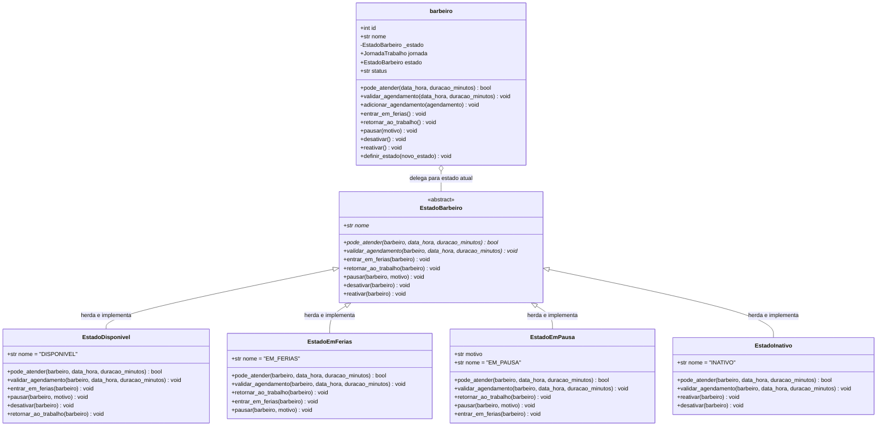
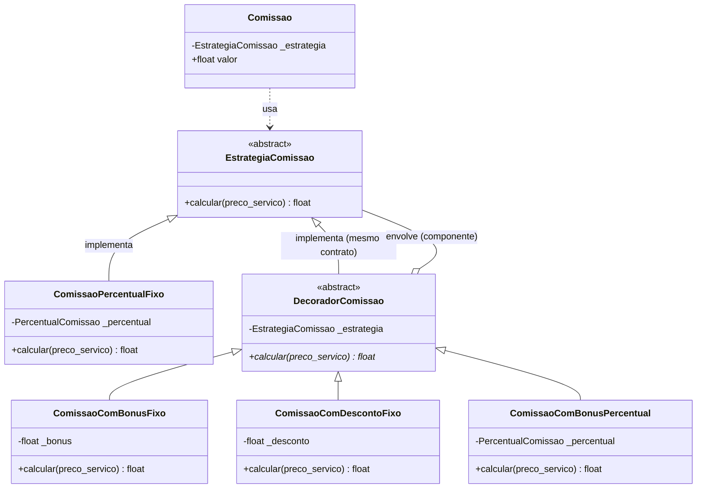

# Padrões de Projeto GoF — BarberTime

Este documento registra a aplicação dos padrões de projeto GoF (*Gang of Four*) no sistema **BarberTime**, conforme os requisitos da **Fase 2 — Checkpoint 3**.

Cada integrante é responsável por implementar e documentar um padrão GoF distinto em seu respectivo módulo/agregado, resolvendo um problema real do domínio da barbearia.

---

## Seção: Jonathan do Nascimento Melo — Agregado Barbeiro

### 1. Nome e Categoria do Padrão

* **Nome do Padrão:** State
* **Categoria:** Comportamental (*Behavioral Pattern*)
* **Definição clássica (GoF):** *"Permite que um objeto altere o seu comportamento quando o seu estado interno muda. O objeto parecerá ter mudado de classe."*

---

### 2. Contexto no Sistema e Problema que ele Resolve

#### 2.1 Contexto do Agregado Barbeiro
No sistema BarberTime, o agregado **Barbeiro** tem como invariante fundamental:
> *"Impedir agendamentos fora do horário de trabalho."*

No Checkpoint 2, extraí a validação de expediente para o Value Object imutável `JornadaTrabalho`. Isso garantiu que horários antes do início, após o término e dias de folga semanal fossem validados de forma isolada e coesa.

#### 2.2 O Problema do Mundo Real
No entanto, no dia a dia operacional de uma barbearia real, a disponibilidade de um profissional não depende apenas de um relógio ou de uma folha de calendário semanal fixa. Barbeiros passam por diferentes **momentos e transições de ciclo de vida funcional**:

1. **Disponível (`DISPONIVEL`):** O barbeiro está em atividade regular e apto a receber agendamentos dentro da sua jornada de trabalho habitual.
2. **Em Férias (`EM_FERIAS`):** O profissional está em gozo de férias regulamentares. Durante esse período, **qualquer agendamento deve ser expressamente bloqueado**, independentemente do horário solicitado coincidir com o expediente padrão. O sistema deve emitir um retorno imediato e explicativo ao cliente ou atendente, sem nem precisar processar horários de início e fim.
3. **Em Pausa / Licença Temporária (`EM_PAUSA`):** O barbeiro precisa se ausentar pontualmente durante o expediente (ex: intervalo prolongado de almoço, treinamento em nova técnica de degradê/barba, consulta médica emergencial). Agendamentos são temporariamente bloqueados com o registro do motivo correspondente.
4. **Inativo (`INATIVO`):** O profissional foi desligado ou desativado temporariamente do sistema. Nenhuma operação de atendimento pode ser realizada e operações normais de ciclo de vida (como solicitar férias) são impedidas até que haja uma reativação expressa.

#### 2.3 Por que o design anterior não atendia
Se tentássemos acomodar esse ciclo de vida com flags booleanas (`em_ferias: bool`, `ativo: bool`, `em_pausa: bool`) na própria classe `barbeiro`, teríamos:
- Proliferação de condicionais encadeadas (`if self.em_ferias: ... elif not self.ativo: ... elif self.em_pausa: ...`) espalhadas por múltiplos métodos (`pode_atender`, `validar_agendamento`, `adicionar_agendamento`, etc.).
- Alto risco de inconsistências de estado: o que acontece se alguém marcar `em_ferias = True` e `ativo = False` ao mesmo tempo?
- Violação do Princípio Aberto/Fechado (OCP): a adição de um novo estado funcional (ex.: licença maternidade/paternidade) obrigaria a reabrir e modificar todos os métodos da entidade de domínio principal.

O padrão **State** resolve esse problema ao encapsular o comportamento e as restrições de cada fase do ciclo de vida em classes dedicadas, permitindo que a entidade `barbeiro` altere seu comportamento de agendamento em tempo de execução através da troca do objeto de estado.

---

### 3. Por que esse Padrão e Alternativas Consideradas

#### 3.1 Alternativa 1 Considerada: Flags Booleanas e Condicionais Procedurais
* **Abordagem:** Incluir campos como `self.em_ferias = False` e `self.ativo = True` na classe `barbeiro`, checando essas variáveis antes de cada validação.
* **Por que foi descartada:** Gera código engessado e difícil de manter. Cada novo status operacional exigiria modificar `barbeiro.py` em diversos pontos, violando o SRP e o OCP. Além disso, as transições válidas de estado (quem pode transitar para onde) ficariam sem proteção, facilitando combinações de dados inválidas.

#### 3.2 Alternativa 2 Considerada: Padrão Strategy
* **Abordagem:** Criar uma interface de estratégia intercambiável para checar a disponibilidade do profissional.
* **Por que foi descartada:** Embora estruturalmente parecidos (ambos usam composição e delegação polimórfica), o propósito semântico do Strategy é isolar uma família de algoritmos intercambiáveis de cálculo pontual sem estado interno duradouro (como o Ruan implementou com perfeição no cálculo de comissão sênior vs júnior no Checkpoint 2). Já o **State** modela uma **máquina de estados finita**, na qual o objeto transita ao longo do tempo por diferentes fases do seu ciclo de vida (`Disponivel` $\rightarrow$ `EmFerias` $\rightarrow$ `Disponivel` $\rightarrow$ `Inativo`), e cada estado conhece as regras permitidas de transição para os demais estados. Para o ciclo de vida do barbeiro, o State é o padrão conceitualmente exato segundo o GoF.

---

### 4. Participantes do Padrão Mapeados no Código Real

| Participante GoF | Classe / Elemento Real no Projeto | Localização | Papel no Sistema |
|---|---|---|---|
| **Context** | `barbeiro` (ou `Barbeiro`) | `src/BarberTime/domain/model.py` | Entidade raiz do agregado. Mantém a referência para o estado atual (`_estado`), delega a validação de disponibilidade e expõe métodos de transição (`entrar_em_ferias`, `retornar_ao_trabalho`, `pausar`, `desativar`, `reativar`). |
| **State (Interface Abstrata)** | `EstadoBarbeiro` | `src/BarberTime/domain/model.py` | Classe base abstrata (`abc.ABC`). Declara os métodos de comportamento (`pode_atender`, `validar_agendamento`) e transição com tratamento padrão defensivo contra transições ilegais. |
| **ConcreteState** | `EstadoDisponivel` | `src/BarberTime/domain/model.py` | Estado padrão ativo. Valida se a data/hora solicitada coincide com o expediente da `JornadaTrabalho`. Permite transição para férias, pausa ou inativo. |
| **ConcreteState** | `EstadoEmFerias` | `src/BarberTime/domain/model.py` | Bloqueia qualquer agendamento informando que o barbeiro está de férias. Permite transição para retorno ao trabalho ou desativação. |
| **ConcreteState** | `EstadoEmPausa` | `src/BarberTime/domain/model.py` | Bloqueia agendamentos temporariamente por motivo pontual (almoço, treinamento). Permite retorno ao trabalho ou desativação. |
| **ConcreteState** | `EstadoInativo` | `src/BarberTime/domain/model.py` | Bloqueia agendamentos e transições operacionais até que o barbeiro seja formalmente reativado. |

---

### 5. Diagrama de Classes (Mermaid)



---

### 6. Testes Automatizados que Exercitam o Padrão

Foram implementados testes unitários tanto na camada de domínio quanto na camada de serviços para validar exaustivamente as invariantes do padrão:

#### 6.1 Testes Unitários de Domínio (`tests/unit/test_barbeiro.py`)
1. **`test_estado_inicial_do_barbeiro_e_disponivel`:** Garante que toda nova instância nasce no `EstadoDisponivel`, mantendo integridade com instâncias já existentes e preservando retrocompatibilidade com o banco de dados.
2. **`test_transicao_para_estado_em_ferias_bloqueia_agendamentos`:** Exercita a chamada `b.entrar_em_ferias()`. Comprova que `b.pode_atender(...)` retorna `False` e `b.validar_agendamento(...)` levanta `ValueError` contendo `"periodo de ferias"`, mesmo quando a requisição é feita para um dia e horário perfeitamente válidos no expediente habitual.
3. **`test_retorno_ao_trabalho_apos_ferias_restaura_disponibilidade`:** Valida o retorno funcional chamando `b.retornar_ao_trabalho()`, confirmando que o barbeiro volta ao estado `DISPONIVEL` e aceita agendamentos normalmente.
4. **`test_estado_em_pausa_bloqueia_atendimento_com_motivo`:** Testa a transição para `EstadoEmPausa(motivo="Horario de almoco")` e assegura que a mensagem de erro detalha a causa da indisponibilidade.
5. **`test_desativacao_e_reativacao_do_barbeiro`:** Valida o ciclo completo de desativação (`INATIVO`) e reativação (`DISPONIVEL`), comprovando que um barbeiro inativo não pode transitar para férias sem ser previamente reativado.
6. **`test_transicoes_invalidas_entre_estados`:** Garante a proteção da máquina de estados, rejeitando ações inconsistentes (ex: tentar colocar em férias um barbeiro que já está de férias).
7. **`test_injecao_polimorfica_de_estado_no_construtor`:** Prova que o construtor do `barbeiro` aceita injeção direta de qualquer subclasse de `EstadoBarbeiro`, atestando o baixo acoplamento.

#### 6.2 Testes de Serviço (`tests/unit/test_services.py`)
* **`test_service_alterar_status_barbeiro_ferias_e_retorno`:** Comprova a orquestração do caso de uso de alteração de status através de `services.alterar_status_barbeiro`.
* **`test_service_validar_horario_bloqueado_quando_barbeiro_em_ferias`:** Valida que o caso de uso `services.validar_horario_atendimento` respeita a máquina de estados do domínio e rejeita agendamentos de profissionais de férias.

---

### 7. Análise de Custo e Benefício da Aplicação do Padrão

#### 7.1 Benefícios Concretos
- **Eliminação de condicionais complexas:** Removeu-se completamente a necessidade de blocos `if/elif/else` aninhados dentro da raiz do agregado.
- **Transições de ciclo de vida seguras:** A própria hierarquia de estados valida se a transição solicitada é legal, impedindo inconsistências de domínio.
- **Extensibilidade e OCP:** Se a barbearia quiser incluir um novo estado (por exemplo, `EstadoAfastamentoMedico` ou `EstadoAtendimentoExterno`), basta criar uma nova subclasse de `EstadoBarbeiro` sem alterar uma única linha dos estados estáveis existentes.
- **Retrocompatibilidade transparente:** Na ausência de estado explícito (inclusive na hidratação imperativa de objetos via SQLAlchemy), o barbeiro assume automaticamente o `EstadoDisponivel`, garantindo que toda a suíte pré-existente continue verde sem necessidade de refazer o esquema do banco.

#### 7.2 Custos e Trade-offs
- **Proliferação de classes no módulo:** Adicionaram-se cinco novas classes (`EstadoBarbeiro`, `EstadoDisponivel`, `EstadoEmFerias`, `EstadoEmPausa`, `EstadoInativo`). Para um sistema excessivamente simples onde barbeiros nunca se ausentam, isso representaria uma sobrecarga estrutural. Porém, para uma barbearia com operação real, essa divisão reflete o domínio com fidelidade.
- **Camada adicional de indireção:** O método `barbeiro.validar_agendamento` delega para `self.estado.validar_agendamento`, que por sua vez consulta a `jornada` do barbeiro quando disponível. Essa navegação de chamada é um custo consciente em troca de clareza e separação de responsabilidades.

---

## Seção: Ruan do Nascimento Silva — Agregado Comissão

### 1. Nome e Categoria do Padrão

* **Nome do Padrão:** Decorator
* **Categoria:** Estrutural (*Structural Pattern*)
* **Definição clássica (GoF):** *"Anexa responsabilidades adicionais a um objeto dinamicamente. Os decorators oferecem uma alternativa flexível ao uso de herança para estender funcionalidades."*

---

### 2. Contexto no Sistema e Problema que ele Resolve

#### 2.1 Contexto do Agregado Comissão
No Checkpoint 2 (SOLID), refatorei o cálculo de comissão com o padrão **Strategy**: a interface `EstrategiaComissao` e as implementações `ComissaoPercentualFixo` (percentual genérico), `ComissaoBarbeiroSenior` (15% fixo) e `ComissaoBarbeiroJunior` (10% com desconto de R$ 5,00 de insumos). Cada política de repasse virou uma subclasse independente, e a entidade `Comissao` passou a receber a estratégia por injeção.

#### 2.2 O Problema Real do Domínio
O Strategy resolveu a troca de *algoritmos completos*, mas revelou um segundo problema: a barbearia vive ajustando o repasse com **complementos transitórios e combináveis** sobre a comissão base, e não apenas com políticas fechadas:

1. **Bônus de meta:** no fim do mês, um barbeiro que superou a meta ganha um bônus fixo (ex.: R$ 10,00) ou percentual (ex.: +5%) sobre o repasse.
2. **Taxas e insumos:** descontos de produtos consumidos no atendimento (lâminas, pomadas) que precisam ser deduzidos do valor.
3. **Promoções pontuais:** dobrar a comissão num feriado, premiar serviço de alta complexidade, etc.

Se cada combinação virasse uma nova subclasse de `EstrategiaComissao`, teríamos uma **explosão combinatória**: `JuniorComBonusDeMeta`, `SeniorComBonusDeMeta`, `JuniorComDescontoDeInsumosEBonusDeMeta`, e assim por diante. O problema concreto é exatamente a evidência disso: `ComissaoBarbeiroJunior` *já esconde* dentro dela um desconto fixo de insumos (10% − R$ 5,00), que é um comportamento ortogonal ao percentual e que não pode ser reaproveitado por outras estratégias sem duplicação.

#### 2.3 Por que o design anterior não atendia
- Cada nova combinação de bônus/taxa exigia **criar (e testar) uma nova subclasse inteira**, violando o OCP e o SRP (uma única classe passava a acumular o percentual *e* o desconto *e* o bônus).
- O `ComissaoBarbeiroJunior` mistura no mesmo lugar a política percentual e a dedução de insumos, impossibilitando compor "percentual X + desconto Y + bônus Z" sem reescrever código.

O **Decorator** resolve isso ao permitir *empilhar* responsabilidades em tempo de execução: uma estratégia base (`ComissaoPercentualFixo`) é envolvida por decoradores (`ComissaoComBonusFixo`, `ComissaoComDescontoFixo`, `ComissaoComBonusPercentual`) que adicionam/removem valores e podem ser combinados em cadeia.

---

### 3. Por que esse Padrão e Alternativas Consideradas

#### 3.1 Alternativa Considerada: Factory Method
* **Abordagem:** Uma `FabricaEstrategiaComissao` que recebe o "nível" do barbeiro (sênior/júnior) e devolve a estratégia pronta, encapsulando a decisão de *qual* classe instanciar.
* **Por que foi descartada:** O Factory Method resolve bem *"qual objeto criar"*, mas não resolve o problema real que identifiquei: a **combinação** de comportamentos (percentual + bônus + desconto). Mesmo com uma fábrica, eu ainda precisaria de uma subclasse para cada combinação possível — a fábrica apenas esconderia a explosão combinatória, sem eliminá-la. Além disso, o Factory exigiria introduzir um atributo de "senioridade" no `barbeiro` (agregado de outro integrante), acoplando minha decisão ao modelo do colega. Como o Strategy já estava em uso e o problema era a *composição de complementos*, o Decorator — que é estrutural e compõe por delegação — foi a escolha semanticamente exata.

---

### 4. Participantes do Padrão Mapeados no Código Real

| Participante GoF | Classe / Elemento Real | Localização | Papel no Sistema |
|---|---|---|---|
| **Component** | `EstrategiaComissao` (ABC) | `src/BarberTime/domain/model.py` | Interface comum do cálculo de comissão. Define `calcular(preco_servico) -> float`. |
| **ConcreteComponent** | `ComissaoPercentualFixo` | `src/BarberTime/domain/model.py` | Objeto que calcula a comissão base (percentual fixo) e recebe os decoradores por composição. |
| **Decorator (abstrato)** | `DecoradorComissao` | `src/BarberTime/domain/model.py` | Herda de `EstrategiaComissao`, guarda a referência ao componente/outro decorador e mantém `calcular` abstrato. |
| **ConcreteDecorator** | `ComissaoComBonusFixo` | `src/BarberTime/domain/model.py` | Soma um bônus fixo (R$) ao resultado do componente envolvido. |
| **ConcreteDecorator** | `ComissaoComDescontoFixo` | `src/BarberTime/domain/model.py` | Deduz uma taxa/desconto fixo (R$, ex.: insumos) com piso em R$ 0,00. |
| **ConcreteDecorator** | `ComissaoComBonusPercentual` | `src/BarberTime/domain/model.py` | Soma um bônus percentual sobre o preço do serviço. |
| **Client** | `Comissao` e `gerar_comissao` | `src/BarberTime/domain/model.py` / `src/BarberTime/service_layer/services.py` | Consomem qualquer `EstrategiaComissao` (base ou decorada) sem conhecer a composição interna. |

---

### 5. Diagrama de Classes (Mermaid)



---

### 6. Testes Automatizados que Exercitam o Padrão

Os testes estão em `tests/unit/test_comissao.py` (domínio) e `tests/unit/test_services_comissao.py` (serviço). O teste central é **`test_decoradores_compostos_em_cadeia`**, que comprova a essência do Decorator ao empilhar `ComissaoComBonusFixo` sobre `ComissaoComDescontoFixo` sobre `ComissaoPercentualFixo` e verificar o resultado combinado (10% − R$ 5,00 + R$ 10,00 = R$ 15,00 sobre R$ 100,00). Complementam-no:

* **`test_desconto_fixo_reproduz_estrategia_junior`** — mostra que o comportamento do `ComissaoBarbeiroJunior` agora é expressável por composição (`ComissaoComDescontoFixo(ComissaoPercentualFixo(10.0), 5.0)`), evidenciando a reutilização que o padrão destrava.
* **`test_decorador_e_subclasse_de_estrategia_comissao`** e **`test_comissao_aceita_decorador_como_estrategia`** — provam a *transparência*: o decorador é indistinguível de uma `EstrategiaComissao` comum, então `Comissao` o aceita sem nenhuma alteração.
* **`test_decorador_abstrato_nao_pode_ser_instanciado`**, **`test_decorador_valida_bonus_negativo`** e **`test_decorador_valida_desconto_negativo`** — garantem o contrato e as invariantes (não negatividade).
* **`test_novo_decorador_sem_modificar_comissao`** — demonstra o OCP: um decorador inédito (`ComissaoComBonusDuplicado`) entra no sistema sem tocar em `Comissao` nem nos decoradores existentes.
* **`test_service_gerar_comissao_com_decorador_bonus_fixo`** e **`test_service_gerar_comissao_com_decorador_em_cadeia`** — exercitam a composição através da camada de serviço `gerar_comissao`, confirmando que o decorador flui pelo caso de uso sem mudanças.

---

### 7. Análise de Custo e Benefício da Aplicação do Padrão

#### 7.1 Benefícios Concretos
- **Elimina a explosão combinatória:** uma nova combinação de bônus/taxa é montada por composição em tempo de execução, não por uma subclasse nova para cada variante.
- **SRP reforçado:** cada decorador tem uma única responsabilidade (somar bônus, deduzir desconto, somar bônus percentual), enquanto antes o `ComissaoBarbeiroJunior` misturava percentual e desconto.
- **Transparência total:** decoradores implementam o mesmo `EstrategiaComissao`, então `Comissao` e `gerar_comissao` os consomem sem qualquer modificação (nenhuma linha de `model.py`/`services.py` precisou ser aberta para "habilitar" o padrão no fluxo de uso).
- **Retrocompatibilidade:** as estratégias `ComissaoBarbeiroSenior`/`ComissaoBarbeiroJunior` foram mantidas intactas, e toda a suíte pré-existente (114 testes) permaneceu verde.

#### 7.2 Custos e Trade-offs
- **Nova hierarquia de classes:** adicionaram-se quatro classes (`DecoradorComissao` e três concretas). Para um cenário sem bônus/taxas, isso é estrutura extra — mas reflete o domínio real da barbearia.
- **Indireção e ordem de composição:** o resultado depende da ordem em que os decoradores são empilhados, o que exige disciplina no ponto de montagem. Em contrapartida, essa mesma composição é o que evita o `if/else` encadeado.
- **Introspecção de tipo no `percentual`:** como decorador não é `ComissaoPercentualFixo`, a comissão serializa `percentual=None` — comportamento já adotado para sênior/júnior e, portanto, consistente com o projeto.

---

## Seção: Marcello Bimbatti Mazzochi — Agregado Agendamento

## Padrão GoF: Strategy 

* **Nome e Categoria:** Strategy (Comportamental).
* **Contexto e Problema:** A validação de disponibilidade na `Agenda` pode variar conforme regras de negócio da barbearia (ex.: validação simples por horário vs. cálculo sobreposição considerando a duração de cada serviço). Encaixar essa lógica dentro do método de agendamento violaria o OCP (Open/Closed Principle).
* **Por que esse padrão (Alternativa considerada):** Foi considerada a alternativa de usar chamadas condicionais (`if/else` com enums de tipo de validação), mas isso tornaria a classe `Agenda` acoplada a novos algoritmos de validação. O **Strategy** permite isolar cada algoritmo de disponibilidade em objetos intercambiáveis.
* **Participantes Mapeados:**
  * `Strategy` (Interface): `RegraDisponibilidade`
  * `ConcreteStrategyA`: `ValidadorHorarioExato`
  * `ConcreteStrategyB`: `ValidadorSuperposicaoHorario`
  * `Context`: `Agenda`
* **Diagrama de Classes (Mermaid):**

```mermaid
classDiagram
    class Agenda {
        -agendamentos: dict
        -validador: RegraDisponibilidade
        +adicionar_agendamento(agendamento)
        +alterar_estrategia_validacao(novo_validador)
    }

    class RegraDisponibilidade {
        <<interface>>
        +validar(agendamento, agendamentos_existentes)*
    }

    class ValidadorHorarioExato {
        +validar(agendamento, agendamentos_existentes)
    }

    class ValidadorSuperposicaoHorario {
        +validar(agendamento, agendamentos_existentes)
    }

    Agenda --> RegraDisponibilidade : usa
    RegraDisponibilidade <|.. ValidadorHorarioExato : implementa
    RegraDisponibilidade <|.. ValidadorSuperposicaoHorario : implementa
